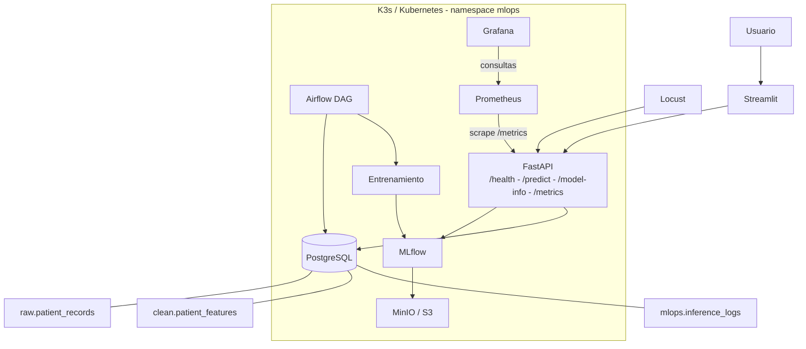
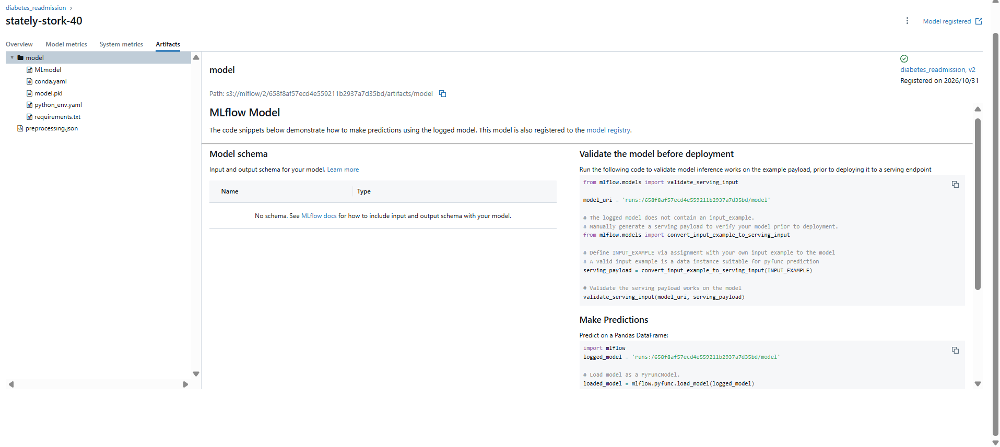
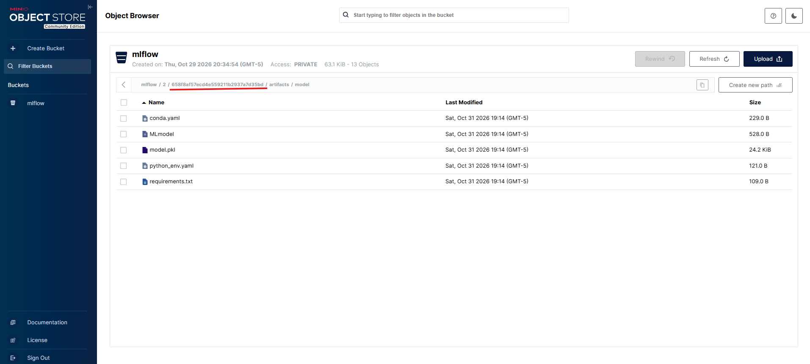
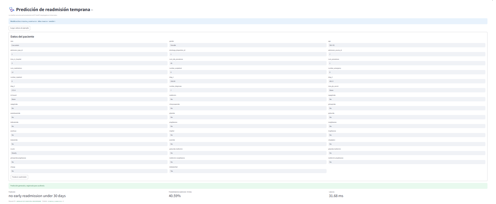

# 🏥 MLOps end-to-end: predicción de readmisión temprana en diabetes

<p align="center">
  
  
  
  
  
</p>

Este proyecto implementa una plataforma MLOps reproducible para estimar la probabilidad de **readmisión hospitalaria antes de 30 días** en pacientes con diabetes. No se limita a entrenar un modelo: automatiza la ingesta, transformación, entrenamiento, registro, serving, auditoría, observabilidad y prueba de carga en Kubernetes.

## 🎯 Resultado principal

- **101.766** encuentros clínicos procesados.
- Modelo registrado: `diabetes_readmission`, versión `1`, alias **`champion`**.
- Ejecución de Airflow con carga incremental de máximo **15.000 registros por lote**.
- **7.884 inferencias** auditadas en PostgreSQL.
- Prueba de carga: **1.868 predicciones exitosas**, **26,3 RPS** y **p95 de 204,23 ms**.

> El objetivo clínico es anticipar readmisiones tempranas (`readmitted == "<30"`). La clase positiva representa el 11,16 % del dataset, por lo cual la selección del modelo privilegia F1 de la clase positiva, junto con recall, ROC-AUC y PR-AUC; no únicamente accuracy.

---

## 🏗️ Arquitectura



### Flujo de datos y serving

```text
Google Drive / Diabetes.csv
        ↓
Airflow: validación → carga incremental → calidad → transformación
        ↓
PostgreSQL: raw → clean
        ↓
Entrenamiento → MLflow Model Registry → alias champion
        ↓                                  ↘ MinIO: artefactos
FastAPI → Streamlit / Locust → PostgreSQL: inference_logs
        ↓
Prometheus (/metrics) → Grafana
```

> Grafana consulta métricas en Prometheus; Prometheus hace *scrape* del endpoint `/metrics` de FastAPI. **Loki no hace parte de este despliegue**: los logs se revisan con `kubectl logs` y la auditoría estructurada vive en PostgreSQL.

---

## ☸️ Kubernetes: evidencia del clúster

Se utilizó **K3s**, una distribución ligera y compatible con Kubernetes, adecuada para una VM de recursos limitados. Se mantuvieron los conceptos estándar de Kubernetes: Pods, Deployments, StatefulSets, Services, ConfigMaps, Secrets, Jobs y PVCs.


Los manifiestos de la infraestructura están en [`k8s/base/`](./k8s/base) y permiten declarar el estado deseado de la plataforma mediante `kubectl apply -f`.

| Recurso | Uso en el proyecto |
|---|---|
| `Deployment` | MLflow, Airflow, FastAPI, Streamlit, Prometheus, Grafana y Locust. |
| `StatefulSet` | PostgreSQL y MinIO, por requerir almacenamiento persistente. |
| `Service` | Direcciones internas estables como `diabetes-api:8000` y `postgres:5432`. |
| `PVC` | Persistencia para PostgreSQL, MinIO, Prometheus y Grafana. |
| `Job` | Inicialización de bucket y primer entrenamiento reproducible. |

---

## 🐳 Imágenes propias y Docker Hub

Las aplicaciones propias se construyeron y publicaron en Docker Hub. Los manifiestos las consumen por tag o digest SHA-256 para evitar depender de imágenes locales de la VM.


| Imagen | Responsabilidad |
|---|---|
| `dac0rtes/mlops-mlflow` | Servidor MLflow con dependencias compatibles. |
| `dac0rtes/mlops-diabetes-trainer` | Descarga, ingesta, transformación y entrenamiento inicial. |
| `dac0rtes/mlops-diabetes-api` | Serving FastAPI y métricas Prometheus. |
| `dac0rtes/mlops-airflow` | DAG y dependencias de orquestación. |
| `dac0rtes/mlops-streamlit` | Interfaz de predicción. |

Ejemplo de referencia inmutable en un manifiesto:

```yaml
image: dac0rtes/mlops-streamlit@sha256:e32122033ffbf7d082c42ea5df5409ca08ea5f9bb07f9ea459f12b20703f9d88
```

---

## 🗃️ Persistencia y trazabilidad

Una sola instancia PostgreSQL (`postgres-0`) hospeda bases lógicas separadas para reducir consumo de la VM sin mezclar responsabilidades:

```text
PostgreSQL
├── airflow: metadatos de DAGs, runs, tareas, XCom y jobs
└── mlops
    ├── raw.patient_records       datos originales
    ├── clean.patient_features    características transformadas
    └── mlops.inference_logs      auditoría de serving
```

Cada registro original contiene `batch_id`, `source_file`, `row_hash`, `payload` JSONB y fecha de carga. El hash único evita duplicados ante reintentos.


---

## 🔄 Orquestación con Airflow

El DAG `diabetes_mlops_pipeline` automatiza y hace visible el pipeline completo:

```text
validate_source
  → incremental_load
  → validate_raw_quality
  → preprocess
  → store_clean_data
  → split_dataset
  → train_model
  → register_model
  → compare_models
  → promote_champion
```


La carga incremental usa `BATCH_SIZE = 15000`; cada lote queda identificado con `batch_id`. La evidencia muestra tanto el límite configurado como el resultado persistido.


### Manejo de errores

El DAG valida fuente y calidad de datos antes de permitir transformación, entrenamiento o promoción. Si una regla falla, la tarea queda en error, Airflow bloquea las tareas dependientes y el incidente queda registrado en los metadatos de la base `airflow`.

---

## 🧪 Experimentos, artefactos y modelo Champion

MLflow centraliza parámetros, métricas, runs y versiones del modelo. PostgreSQL conserva los metadatos; MinIO, compatible con S3, conserva los artefactos del modelo.

| Métrica de prueba | Resultado |
|---|---:|
| F1 positiva | 0,2625 |
| Precision positiva | 0,1724 |
| Recall positivo | 0,5500 |
| ROC-AUC | 0,6516 |
| PR-AUC | 0,2089 |





La API resuelve el modelo mediante:

```text
models:/diabetes_readmission@champion
```

De esta forma, una promoción de modelo no obliga a cambiar el contrato de FastAPI ni de Streamlit.

---

## 🚀 Serving: FastAPI y Streamlit

FastAPI es la única puerta de serving. Expone:

| Endpoint | Función |
|---|---|
| `GET /health` | Estado del servicio. |
| `GET /model-info` | Nombre, alias y versión del modelo activo. |
| `POST /predict` | Predicción validada y auditada. |
| `GET /metrics` | Métricas para Prometheus. |

Streamlit consume exclusivamente FastAPI; no accede directamente a PostgreSQL, MinIO ni MLflow. Cada predicción registra `request_id`, entrada, salida, score, modelo, versión y latencia en `mlops.inference_logs`.



---

## 📈 Observabilidad y prueba de carga

Prometheus realiza *scrape* de FastAPI cada 5 segundos. Grafana presenta solicitudes exitosas, errores de validación, RPS y latencia p95. La carga se genera con Locust desde un Pod que llama al Service interno `diabetes-api:8000`.


| Indicador observado | Resultado |
|---|---:|
| Usuarios virtuales | 10 |
| Solicitudes exitosas visibles | 1.868 |
| RPS observado | 26,3 |
| Latencia p95 | 204,23 ms |
| Errores de validación controlados | 1 |
| Inferencias auditadas al cierre | 7.884 |
| Latencia promedio auditada | 57,21 ms |

---

## 🛠️ Retos técnicos y decisiones

| Reto | Solución aplicada | Aprendizaje |
|---|---|---|
| Rango de red de K3s se solapaba con la red de la VM. | Reinstalación con Pods `10.244.0.0/16` y Services `10.245.0.0/16`. | Validar CIDRs antes de desplegar. |
| `DiskPressure` expulsaba Pods. | Retiro dirigido de Rancher y recursos de prácticas previas; revisión de disco y runtime. | No hacer limpieza indiscriminada de volúmenes. |
| Imagen inicial de MinIO no estaba disponible. | Uso de imagen mantenida de Chainguard y ajuste del Job de bucket. | Verificar disponibilidad y capacidades reales de las imágenes. |
| MLflow fallaba con SQLAlchemy reciente. | Fijar `SQLAlchemy==2.0.54`, reconstruir y publicar imagen. | Fijar versiones de dependencias críticas. |
| Scheduler de Airflow reiniciaba. | Reemplazar probe pesado por verificación ligera del proceso. | Un probe debe medir salud sin provocar falsos positivos. |
| Servicios no eran visibles fuera del clúster. | `ClusterIP` interno + `kubectl port-forward` y firewall 8000-8007. | Separar red interna de la exposición temporal para demo. |

---

## 📦 Estructura del repositorio

```text
.
├── airflow/
│   ├── dags/diabetes_mlops_dag.py
│   ├── Dockerfile
│   └── requirements.txt
├── api/
├── k8s/base/
│   ├── postgres.yaml
│   ├── minio.yaml
│   ├── mlflow.yaml
│   ├── airflow.yaml
│   ├── api.yaml
│   ├── streamlit.yaml
│   ├── prometheus.yaml
│   ├── grafana.yaml
│   ├── locust.yaml
│   └── trainer-job.yaml
├── locust/
├── mlflow/
├── streamlit/
├── trainer/
└── docs/
    └── guion_video_mlops_diabetes.pdf
```

---

## ▶️ Reproducción resumida

### 1. Verificar el clúster

```bash
kubectl get nodes -o wide
kubectl top nodes
kubectl get storageclass
```

### 2. Desplegar por dependencias

```bash
kubectl apply -f k8s/base/postgres.yaml
kubectl apply -f k8s/base/minio.yaml
kubectl apply -f k8s/base/mlflow.yaml
kubectl apply -f k8s/base/airflow.yaml
kubectl apply -f k8s/base/api.yaml
kubectl apply -f k8s/base/streamlit.yaml
kubectl apply -f k8s/base/prometheus.yaml
kubectl apply -f k8s/base/grafana.yaml
kubectl apply -f k8s/base/locust.yaml
```

> Las credenciales no se publican en Git. Antes del despliegue deben crearse los Secrets de PostgreSQL, MinIO, Airflow y Grafana con valores propios.

### 3. Validar el estado

```bash
kubectl -n mlops get deploy,statefulset,job
kubectl -n mlops get pods --field-selector=status.phase=Running -o wide
kubectl -n mlops get svc,pvc
```

### 4. Exponer interfaces para demo local

| Servicio | URL externa | Port-forward |
|---|---|---|
| FastAPI / Swagger | `http://IP_VM:8000/docs` | `svc/diabetes-api 8000:8000` |
| MLflow | `http://IP_VM:8001` | `svc/mlflow 8001:5000` |
| MinIO | `http://IP_VM:8002` | `svc/minio 8002:9001` |
| Prometheus | `http://IP_VM:8003` | `svc/prometheus 8003:9090` |
| Grafana | `http://IP_VM:8004` | `svc/grafana 8004:3000` |
| Streamlit | `http://IP_VM:8005` | `svc/streamlit 8005:8501` |
| Locust | `http://IP_VM:8006` | `svc/locust 8006:8089` |
| Airflow | `http://IP_VM:8007` | `svc/airflow-webserver 8007:8080` |

Ejemplo:

```bash
kubectl -n mlops port-forward --address 0.0.0.0 \
  svc/streamlit 8005:8501
```
