# 🏠 Proyecto Final MLOps: predicción de precios inmobiliarios

**Video de sustentación:** [Ver la presentación del proyecto en YouTube](https://youtu.be/q6_7yfhtR1M)

<p align="center">
  
  
  
  
  
</p>

Plataforma MLOps end-to-end para estimar el precio de inmuebles. El proyecto procesa lotes incrementales entregados por una API docente, conserva trazabilidad por capas **Bronze / Silver / Gold**, entrena y registra un modelo en MLflow, publica predicciones mediante FastAPI y las expone en Streamlit.

El despliegue está diseñado para una VM de recursos limitados: K3s, almacenamiento persistente acotado, imágenes versionadas y GitOps con Argo CD.

---

## 🎯 Resultado actual

- Ingesta incremental real desde `cristiandiaz13/mlops-puj:data-api-pf-v2`, grupo 5.
- DAG `property_batch_ingestion` ejecutado exitosamente con persistencia Bronze, Silver y Gold.
- Reproducción histórica con Airflow: lote 4 omitido y lote 5 entrenado y registrado en MLflow. La ejecución con la imagen publicada generó el candidato v4 y dejó la promoción en revisión.
- Modelo `property_price_model`, versión **1**, alias **`champion`** en MLflow.
- Recarga de FastAPI verificada con un cambio temporal **v1 → v3 → v1**, en el mismo pod y con cero reinicios.
- Primera evaluación: **MAE 41.027,94**, **RMSE 49.531,39** y **R² 0,2332**.
- API de predicción, interfaz Streamlit, Prometheus, Grafana y Locust conectados al caso de precios.
- Cadena de despliegue demostrada: `push a main → GitHub Actions → Docker Hub → manifiesto GitOps → Argo CD → K3s`.

---

## 🏗️ Arquitectura

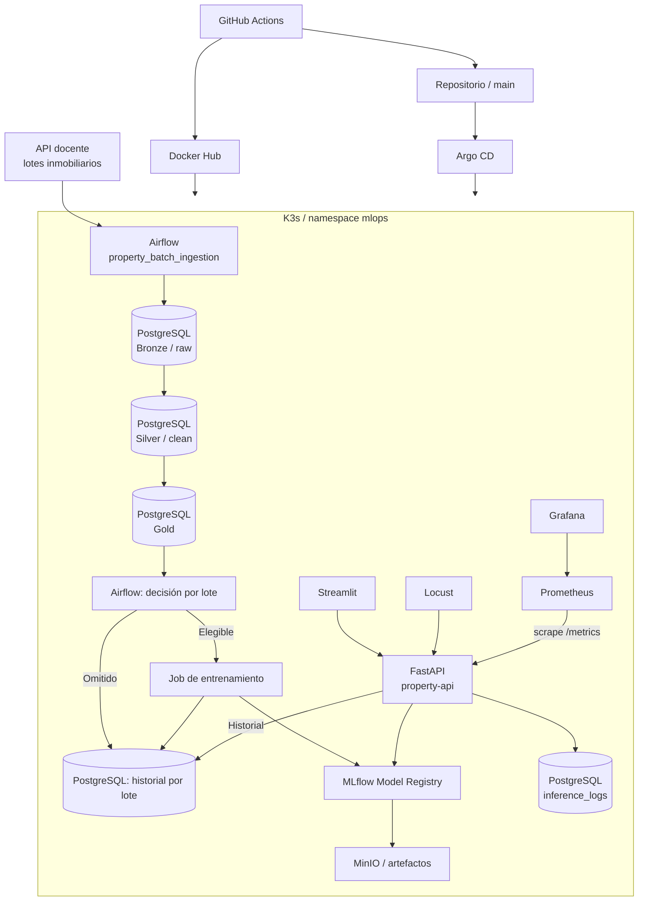

### Flujo end-to-end

```text
Nuevo lote de datos
  → Airflow: Bronze → validación → Silver → Gold
  → Airflow decide si omite o dispara el Job de entrenamiento
  → MLflow: versión y alias champion
  → FastAPI: /predict, auditoría y métricas
  → Streamlit y Locust consumen la API
  → Prometheus / Grafana observan el serving
  → GitHub Actions y Argo CD versionan y despliegan cambios
```

---

## 📸 Evidencia funcional

### GitOps: plataforma sincronizada

Argo CD observa `main/k8s`, aplica los manifiestos y mantiene la plataforma en estado `Synced / Healthy`. El árbol confirma que Airflow, Data API, JupyterLab, serving, observabilidad y Streamlit están desplegados como recursos administrados.


### Prueba de carga y observabilidad

Locust ejecutó 705 solicitudes contra `property-api`, con 0 fallos y 5,2 RPS agregados. Grafana recibió las métricas Prometheus del mismo intervalo: 569 predicciones exitosas, modelo champion cargado y latencia p95 de 47,69 ms.


### Integración continua e imágenes inmutables

GitHub Actions construyó la imagen de Airflow y la publicó en Docker Hub con un tag SHA inmutable. Este patrón permite identificar exactamente qué versión fue desplegada.

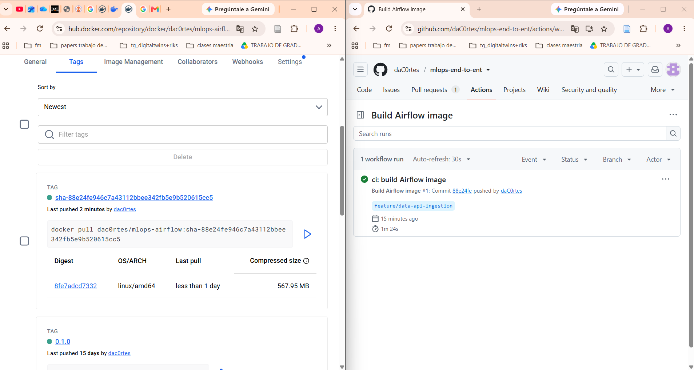

El panel lista los workflows de las imágenes propias. Las ejecuciones visibles en verde corresponden a JupyterLab y Streamlit; la captura anterior muestra además el build de Airflow y su tag en Docker Hub.

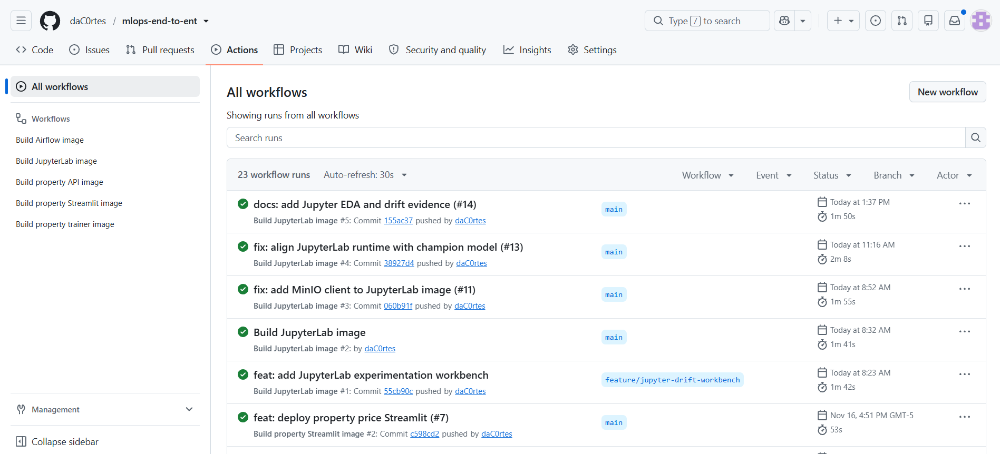

El trabajo se integró mediante Pull Requests cerrados y fusionados, conservando una historia auditable de funcionalidades, correcciones y evidencias.

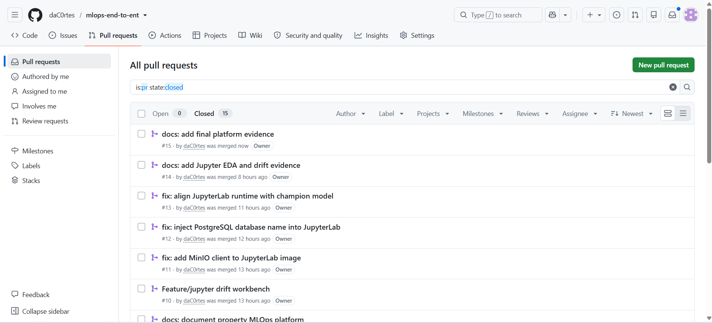

### Airflow y trazabilidad por lote

La ejecución seleccionada de `property_batch_ingestion` completó las cinco tareas hasta Gold. El historial también conserva ejecuciones con otros estados.

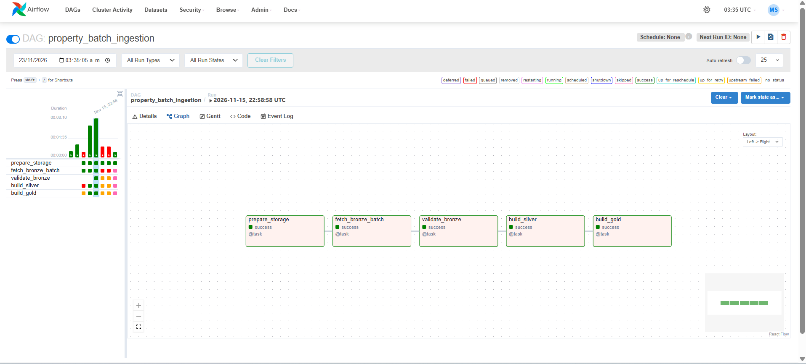

La consulta de auditoría cruza el identificador de Bronze con los conteos de Silver y Gold. La captura registra un corte histórico: `group-5-batch-4` alcanzó Gold con 320.696 filas.

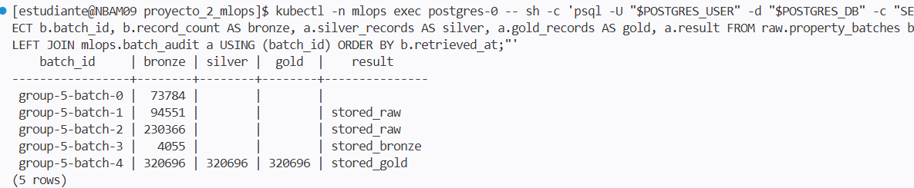

### MLflow y exploración en JupyterLab

El experimento `property_price_regression` reúne el entrenamiento que originó `property_price_model` v1, los runs de EDA y la evaluación de drift del lote 5.

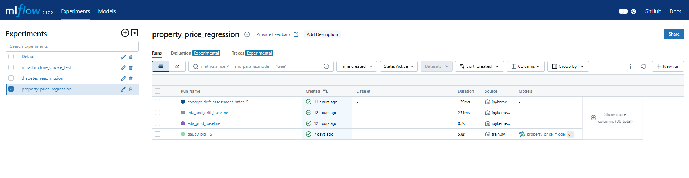

El reporte Sweetviz, generado en JupyterLab a partir de 10.000 filas de Gold, quedó guardado como artefacto en MLflow. El histograma de `target_price` caracteriza la referencia inicial.

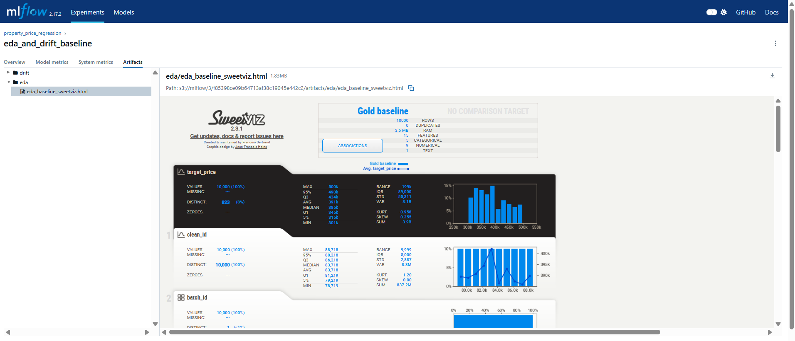

### Decisión de entrenamiento por lote en Airflow

El DAG de vista previa consultó dos lotes históricos en Gold. El lote 4 devolvió `skip` porque su auditoría no confirmaba la calidad de Bronze. El lote 5 devolvió `eligible`: la variación total de `house_size` frente al lote 4 fue 0,2773, superior al umbral de 0,20. Las nuevas ciudades representaron el 4,48 % de las filas con ciudad, por debajo del umbral de 10 %. La vista previa opera en solo lectura.

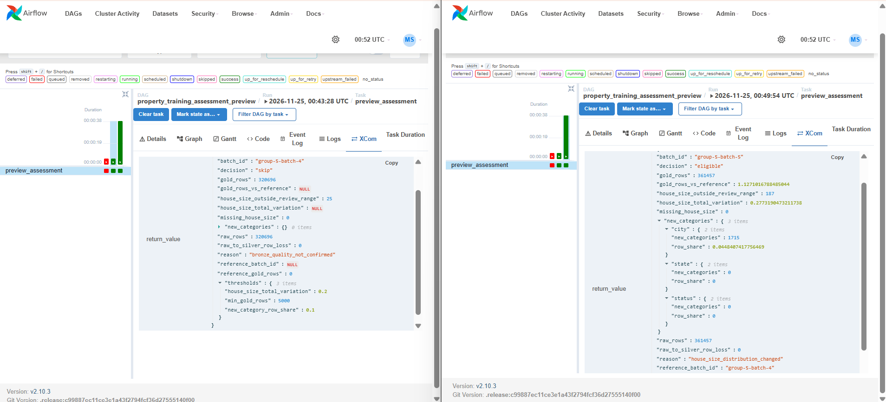

En la corrida de vista previa del 26 de noviembre de 2026 a las 23:38 UTC, Airflow verificó la calidad de `house_size` en Gold antes de comparar los lotes. El lote 4 pasó como referencia con 320.671 tamaños válidos de 320.696 (99,99 %) y el lote 5 tuvo 361.270 de 361.457 (99,95 %). La regla exige al menos 5.000 tamaños válidos y 95 % de cobertura. Un tamaño válido es mayor que 0 y de hasta 20.000 pies cuadrados. El control de Gold y la confirmación histórica de Bronze se evalúan por separado.

El XCom registró 682.153 filas Gold acumuladas y una variación total de 0,2771 frente al umbral de 0,20. Airflow devolvió `eligible` con el motivo `house_size_distribution_changed`. Las 1.715 ciudades nuevas representaron el 4,48 % de las filas con ciudad, por debajo del umbral del 10 %. La corrida se limitó a evaluar la elegibilidad.

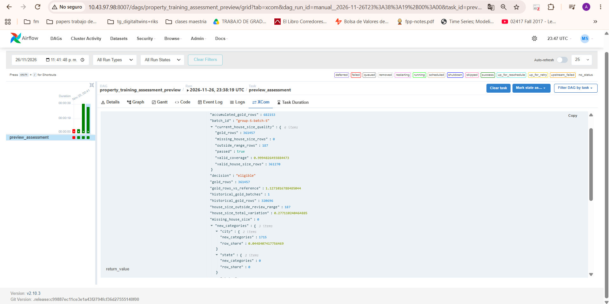

### Entrenamiento orquestado y trazabilidad

En las primeras ejecuciones del DAG `property_training_replay`, se reutilizaron lotes ya persistidos. La del lote 4 ejecutó `skip_training`. En la del lote 5, `train_candidate` lanzó el Job de Kubernetes y `hold_promotion` registró el resultado sin modificar el alias productivo. La ruta de ingesta y el replay comparten la lógica de decisión y entrenamiento.

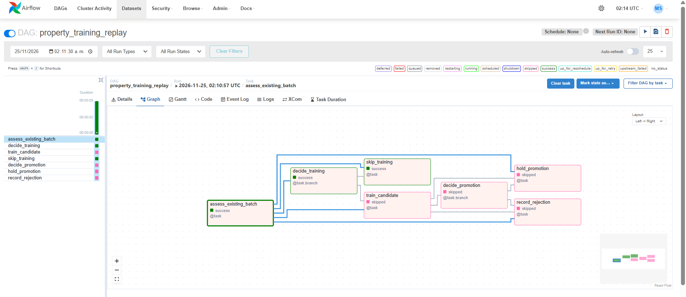

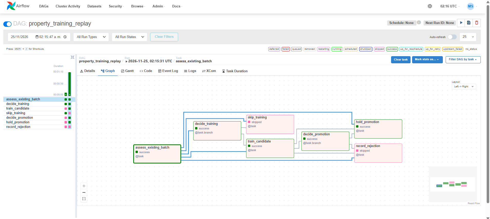

| Lote | Estado en `mlops.property_training_runs` | Job de Kubernetes | Run de MLflow | Versión candidata |
|---|---|---|---|---|
| `group-5-batch-4` | `training_skipped` | — | — | — |
| `group-5-batch-5` | `promotion_held` | `property-candidate-67141ada4ef7e8aac380f504` | `2d61d2a8135a47aba1b55694728da368` | v3 |

En la corrida del **26 de noviembre de 2026 a las 19:08:12 de Bogotá** (27 de noviembre a las 00:08:12 UTC), Airflow volvió a evaluar `group-5-batch-5` con `use_cached_runtime=false`. Esta configuración selecciona la imagen `dac0rtes/mlops-property-trainer:sha-f5d57f01948919b8487b437114534d66d6432b0b` en el Job. La captura vincula el XCom de `train_candidate` con el run `e2a61ef831154e8f8a1732a38fc39c38` de MLflow, que registra el lote, el SHA del entrenador y el motivo `house_size_distribution_changed`.

Sobre el mismo conjunto de prueba del lote 5, el candidato v4 bajó el **MAE de 722.390,84 a 374.534,05 (48,15 %)** y el **RMSE de 1.560.576,20 a 1.009.044,44 (35,34 %)** frente al champion v1. El resultado `eligible_for_promotion` activó `hold_promotion`. El XCom registra `promoted: false` y MLflow muestra `promotion_mode: held_for_review`. La comparación corresponde a este lote y la exposición histórica del champion a las filas de prueba sigue sin verificarse.

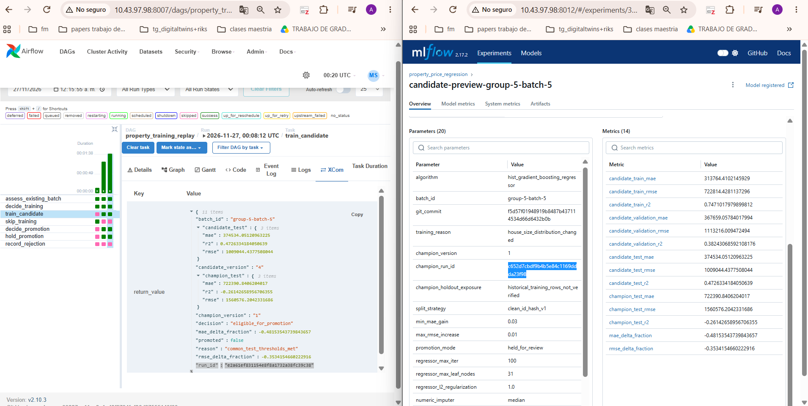

---

## 🥉🥈🥇 Capas de datos

| Capa | Tabla | Propósito |
|---|---|---|
| Bronze / RAW | `raw.property_batches` | Respuesta original de cada lote, identificador, fecha, hash, conteo y payload como texto. |
| Silver / CLEAN | `clean.property_records` | Registros normalizados y deduplicados por `row_hash`. |
| Gold | `gold.property_training_features` | Variables tipadas listas para entrenar el modelo de precio. |
| Auditoría | `mlops.batch_audit` | Esquema recibido, validaciones, conteos y resultado por lote. |
| Historial de entrenamiento | `mlops.property_training_runs` | Decisión por ejecución, modo, Job, comparación y run de MLflow. |

La respuesta RAW se almacena como `TEXT`, no como JSONB completo. Un lote real de 16,4 MB produjo `OOMKilled` al transformarlo directamente en PostgreSQL con 1 GiB; conservar el cuerpo original y transformar por etapas controla el consumo de memoria.

---

## 🔄 Orquestación con Airflow

El DAG `property_batch_ingestion` procesa un evento de datos por ejecución:

```text
prepare_storage
  → fetch_bronze_batch
  → validate_bronze
  → build_silver
  → build_gold
  → assess_training
  → decide_training
    ├─ skip_training
    └─ train_candidate → decide_promotion → hold_promotion / record_rejection
```

Controles incluidos:

- Consulta incremental: cada llamada consume un lote nuevo del grupo asignado.
- Validación de columnas esperadas y proporción válida de precios.
- Deduplicación por hash en Silver.
- Auditoría de conteos Bronze, Silver y Gold.
- HTTP 400 por lotes agotados tratado como final controlado, no como caída del DAG.

---

## 🧪 Modelo, registro y promoción

El Job `property-price-training` lee Gold y usa una muestra máxima de 75.000 filas para respetar los límites de memoria de la VM. El modelo es un `HistGradientBoostingRegressor` con tratamiento de variables numéricas y categóricas.

MLflow registra parámetros, métricas, contrato de datos y el artefacto del modelo. La API resuelve siempre:

```text
models:/property_price_model@champion
```

FastAPI resuelve el alias al iniciar y lo consulta periódicamente en MLflow (cada 60 s por defecto). Ante un cambio, descarga la versión exacta, comprueba el contrato de columnas y vuelve a verificar el alias antes de reemplazar el modelo en memoria. Cada solicitud usa un único modelo y su versión durante toda la inferencia y la auditoría. Si falla la recarga, la versión activa sigue atendiendo.

La [bitácora de experimentación](jupyter/notebooks/README.md) documenta el cambio de distribución entre los lotes 4 y 5 y los primeros candidatos evaluados en JupyterLab. En un primer ensayo se lanzó manualmente el Job que registró v2. En el replay posterior, Airflow lanzó el Job que registró v3. Ambos ensayos reutilizaron la imagen local de JupyterLab para evitar otra descarga en el nodo. El champion siguió en v1.

El Job reservó un conjunto de prueba mediante una partición determinista por `clean_id` y evaluó en él al candidato v2 y al champion v1. La regla exige al menos 3 % de mejora en MAE y que el RMSE no empeore más de 1 %. Se prioriza MAE porque expresa directamente el error absoluto de precio; RMSE limita el deterioro ante errores grandes.

| Métrica en el test del lote 5 | Champion v1 | Candidato v2 | Reducción |
|---|---:|---:|---:|
| MAE | 722.391 | 374.534 | 48,15 % |
| RMSE | 1.560.576 | 1.009.044 | 35,34 % |

El run `10d1f09cc7f549ba824fe3eb12d64cf0` registró `eligible_for_promotion` y conservó v1 como `champion`. El resultado corresponde al test del lote 5; la exposición histórica del champion a esas filas quedó sin verificar.

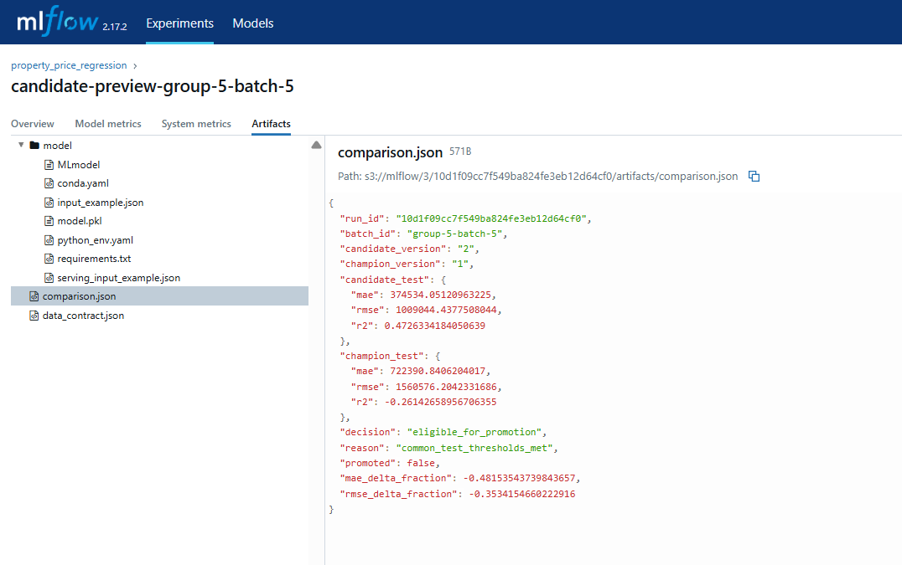

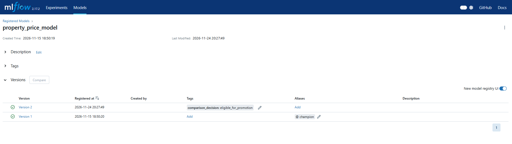

---

## 🚀 Serving e interfaz

### FastAPI

`property-api` expone:

| Endpoint | Uso |
|---|---|
| `GET /health` | Comprueba disponibilidad de PostgreSQL y del modelo. |
| `GET /model-info` | Nombre, alias, versión y variables esperadas. |
| `GET /training-history` | Última decisión registrada por lote, con comparación y referencia al run de MLflow. |
| `POST /predict` | Valida el contrato, estima precio y registra auditoría. |
| `GET /metrics` | Métricas Prometheus de predicciones, errores y latencia, versión activa (`property_served_model_info`) y fallos de recarga. |

Cada inferencia guarda `request_id`, payload, precio estimado, modelo, versión y latencia en `mlops.inference_logs`.

#### Recarga sin redespliegue

En una prueba controlada, se verificó que v3 aceptaba el contrato del formulario y se apuntó temporalmente el alias `champion` a esa versión. `/model-info` pasó de v1 a v3. Al restaurar el alias, la API volvió a v1. El pod mantuvo el UID `e122bb42-7c62-415f-96cb-ab7aeb7d0b51` y reportó cero reinicios. La prueba demuestra el cambio en el proceso activo; v3 se probó como sustitución temporal, y v1 quedó en producción. El resultado de evaluación de v3 corresponde al lote 5.

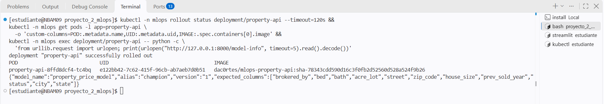

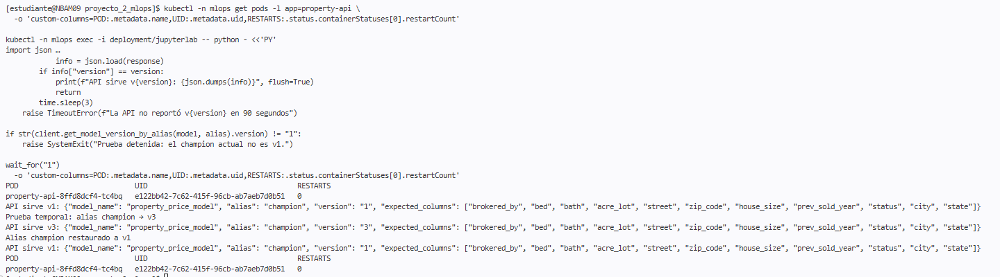

### Streamlit

La interfaz consulta `property-api`. La vista de **Predicción** muestra el precio estimado, la latencia, la versión usada y el identificador de la solicitud. **Historial por lote** muestra la última decisión registrada, los motivos, las variaciones de MAE y RMSE, las versiones y el run de MLflow. Los lotes anteriores sin registro de entrenamiento aparecen como **Sin decisión registrada**.

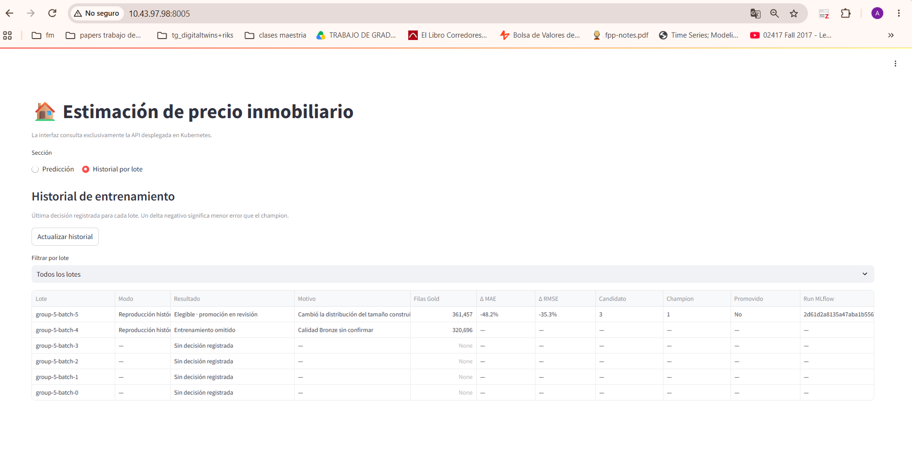

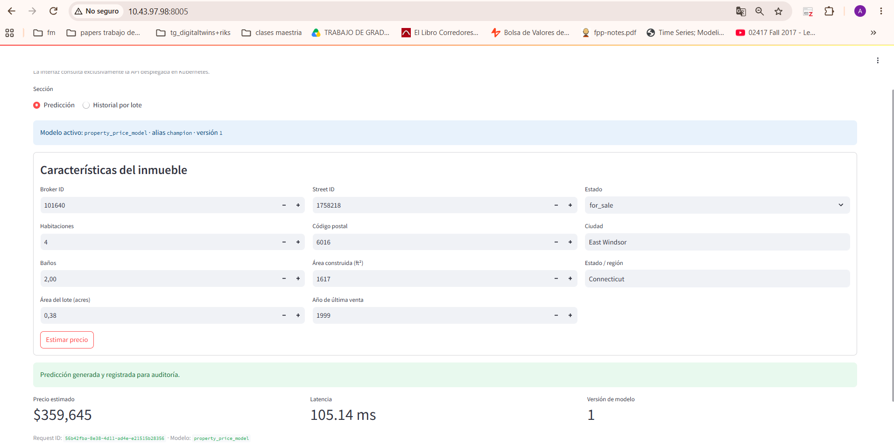

### Auditoría, recursos y monitoreo en servicio

La pantalla dividida cruza la predicción de Streamlit con su fila en PostgreSQL consultada desde JupyterLab. El Request ID `56b42fba-8e38-4d11-ad4e-e21515b28356` vincula la petición con el precio guardado de **359.645,29**, la latencia de **105,14 ms** y la versión **1**. Argo CD muestra la configuración en vivo de la API: reserva **250m de CPU y 512 MiB de RAM**, con límites de **1 CPU y 1 GiB**. Prometheus muestra el target `property-api` en **UP** y la métrica `property_served_model_info` identifica el alias `champion` y la versión **1**.

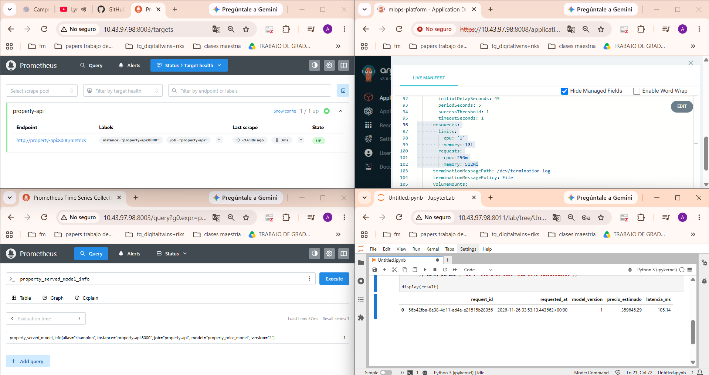

---

## 📈 Observabilidad y carga

- **Prometheus** hace scrape de `property-api:8000/metrics` cada 5 segundos.
- **Grafana** muestra predicciones, errores, estado del modelo `champion`, latencia p95 y tasa de error.
- **Locust** simula usuarios contra el Service interno `property-api:8000`; 80% de las tareas usan `/predict` y 20% `/health`.

La carga se mantiene controlada para la VM: se recomienda iniciar con 5 usuarios y tasa de incorporación de 1 usuario por segundo. La corrida observada atendió 705 solicitudes sin fallos y el panel de Grafana mostró un p95 de 47,69 ms. La medición de 105,14 ms de la captura de auditoría corresponde a una predicción individual en otro momento. Para estimar el punto de saturación harían falta escalones adicionales de carga y una serie simultánea de CPU y memoria.

Los recursos de la API se leen en Argo CD. El manifiesto de bootstrap de MinIO declara reservas y límites para su contenedor de configuración y el de creación del bucket. El Job se ejecuta por separado del despliegue habitual.

---

## 🔁 CI/CD y GitOps

### GitHub Actions

Los workflows construyen imágenes versionadas con el SHA del commit:

| Workflow | Imagen |
|---|---|
| `build-airflow.yml` | `dac0rtes/mlops-airflow:sha-<commit>` |
| `build-trainer.yml` | `dac0rtes/mlops-property-trainer:sha-<commit>` |
| `build-property-api.yml` | `dac0rtes/mlops-property-api:sha-<commit>` |
| `build-property-streamlit.yml` | `dac0rtes/mlops-property-streamlit:sha-<commit>` |

Para API y Streamlit, un push a `main` construye la imagen, actualiza automáticamente el tag correspondiente en el manifiesto y hace commit de despliegue. El cambio de manifiesto no dispara un bucle de build.

### Argo CD

La Application `mlops-platform` observa `main/k8s` y se validó como **Synced / Healthy**. El archivo `k8s/kustomization.yaml` define los servicios que Argo administra:

```text
data-api · Airflow · property-api · Prometheus · Grafana · Streamlit · Locust · JupyterLab
```

El Job de entrenamiento está deliberadamente fuera de esa lista: una sincronización GitOps no debe relanzar un entrenamiento por accidente.

---

## 🛠️ Retos técnicos y decisiones

| Reto | Decisión | Aprendizaje |
|---|---|---|
| `/var` se llenó con datos de K3s. | Migración a `/opt/k3s-data`. | Revisar disco antes de descargar imágenes o escalar servicios. |
| Data API fallaba con 256 MiB. | Límite de 1 GiB y probes TCP. | La memoria debe dimensionarse con lotes reales. |
| PostgreSQL fue OOM al usar JSONB completo. | RAW como `TEXT`; transformación por capas. | Preservar trazabilidad no implica transformar todo en memoria. |
| Scheduler Airflow se reiniciaba. | Sonda TCP al puerto 8793. | Un liveness probe mal diseñado puede causar la falla que pretende detectar. |
| Grafana conservó metadatos del dashboard antiguo. | UID y archivo de provisión nuevos. | ConfigMaps y PVCs pueden tener tiempos de actualización diferentes. |
| Rama Git tuvo conflicto tras Squash merge. | Rebase con backup y `--force-with-lease`. | Squash cambia la historia; no reutilizar una rama fusionada sin rebasarla. |

---

## 📦 Estructura del repositorio

```text
.
├── .github/workflows/      # CI y actualización de tags GitOps
├── airflow/dags/           # property_ingestion_dag.py
├── api/                    # FastAPI de serving
├── argocd/                 # Application mlops-platform
├── k8s/
│   ├── base/               # Manifiestos Kubernetes
│   └── kustomization.yaml  # Alcance administrado por Argo CD
├── locust/                 # Prueba de carga
├── streamlit/              # Interfaz de precio
├── trainer/                # Entrenamiento y registro MLflow
└── docs/                   # Handoff y material de sustentación
```

---

## ▶️ Operación y demo local

### Salud mínima

```bash
df -h / /var /home
kubectl top node
kubectl -n mlops get pods
kubectl -n argocd get applications
```

### Interfaces de demostración

| Servicio | URL | Port-forward |
|---|---|---|
| FastAPI / Swagger | `http://IP_VM:8010/docs` | `svc/property-api 8010:8000` |
| MLflow | `http://IP_VM:8012` | `svc/mlflow 8012:5000` |
| JupyterLab | `http://IP_VM:8011/lab` | `svc/jupyterlab 8011:8888` |
| Prometheus | `http://IP_VM:8003` | `svc/prometheus 8003:9090` |
| Grafana | `http://IP_VM:8004` | `svc/grafana 8004:3000` |
| Streamlit | `http://IP_VM:8005` | `svc/streamlit 8005:8501` |
| Locust | `http://IP_VM:8006` | `svc/locust 8006:8089` |
| Airflow | `http://IP_VM:8007` | `svc/airflow-webserver 8007:8080` |
| Argo CD | `https://IP_VM:8008` | `svc/argocd-server 8008:443` |

Ejemplo:

```bash
kubectl -n mlops port-forward --address 0.0.0.0 \
  svc/streamlit 8005:8501
```

> Las credenciales no se publican en Git. Antes de cualquier demostración, confirmar que no existen `DiskPressure` ni Pods en error.

---

