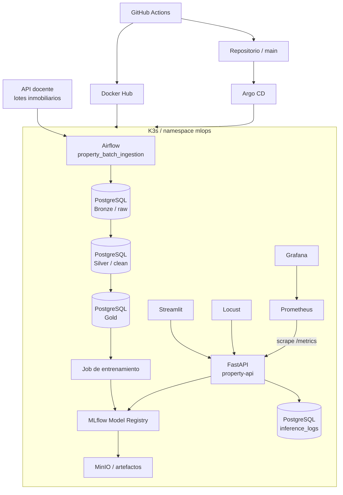
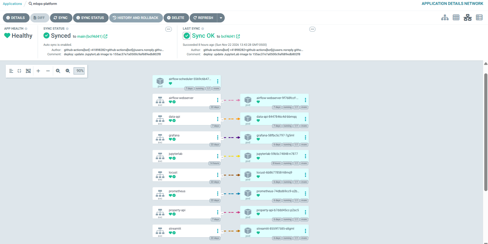
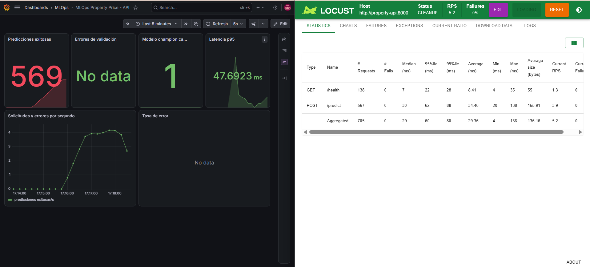

# 🏠 Proyecto Final MLOps: predicción de precios inmobiliarios

<p align="center">
  
  
  
  
  
</p>

Plataforma MLOps end-to-end para estimar el precio de inmuebles. El proyecto procesa lotes incrementales entregados por una API docente, conserva trazabilidad por capas **Bronze / Silver / Gold**, entrena y registra un modelo en MLflow, publica predicciones mediante FastAPI y las expone en Streamlit.

El despliegue está diseñado para una VM de recursos limitados: K3s, almacenamiento persistente acotado, imágenes versionadas y GitOps con Argo CD.

---

## 🎯 Resultado actual

- Ingesta incremental real desde `cristiandiaz13/mlops-puj:data-api-pf-v2`, grupo 5.
- DAG `property_batch_ingestion` ejecutado exitosamente con persistencia Bronze, Silver y Gold.
- Modelo `property_price_model`, versión **1**, alias **`champion`** en MLflow.
- Primera evaluación: **MAE 41.027,94**, **RMSE 49.531,39** y **R² 0,2332**.
- API de predicción, interfaz Streamlit, Prometheus, Grafana y Locust conectados al caso de precios.
- Cadena de despliegue demostrada: `push a main → GitHub Actions → Docker Hub → manifiesto GitOps → Argo CD → K3s`.

---

## 🏗️ Arquitectura



### Flujo end-to-end

```text
Nuevo lote de datos
  → Airflow: Bronze → validación → Silver → Gold
  → Job de entrenamiento
  → MLflow: versión y alias champion
  → FastAPI: /predict, auditoría y métricas
  → Streamlit y Locust consumen la API
  → Prometheus / Grafana observan el serving
  → GitHub Actions y Argo CD versionan y despliegan cambios
```

---

## 📸 Evidencia funcional

### GitOps: plataforma sincronizada

Argo CD observa `main/k8s`, aplica los manifiestos y mantiene la plataforma en estado `Synced / Healthy`. El árbol confirma que Airflow, Data API, JupyterLab, serving, observabilidad y Streamlit están desplegados como recursos administrados.



### Prueba de carga y observabilidad

Locust ejecutó 705 solicitudes contra `property-api`, con 0 fallos y 5,2 RPS agregados. Grafana recibió las métricas Prometheus del mismo intervalo: 569 predicciones exitosas, modelo champion cargado y latencia p95 de 47,69 ms.



### Integración continua e imágenes inmutables

GitHub Actions construyó la imagen de Airflow y la publicó en Docker Hub con un tag SHA inmutable. Este patrón permite identificar exactamente qué versión fue desplegada.


---

## 🥉🥈🥇 Capas de datos

| Capa | Tabla | Propósito |
|---|---|---|
| Bronze / RAW | `raw.property_batches` | Respuesta original de cada lote, identificador, fecha, hash, conteo y payload como texto. |
| Silver / CLEAN | `clean.property_records` | Registros normalizados y deduplicados por `row_hash`. |
| Gold | `gold.property_training_features` | Variables tipadas listas para entrenar el modelo de precio. |
| Auditoría | `mlops.batch_audit` | Esquema recibido, validaciones, conteos y resultado por lote. |

La respuesta RAW se almacena como `TEXT`, no como JSONB completo. Un lote real de 16,4 MB produjo `OOMKilled` al transformarlo directamente en PostgreSQL con 1 GiB; conservar el cuerpo original y transformar por etapas controla el consumo de memoria.

---

## 🔄 Orquestación con Airflow

El DAG `property_batch_ingestion` procesa un evento de datos por ejecución:

```text
prepare_storage
  → fetch_bronze_batch
  → validate_bronze
  → build_silver
  → build_gold
```

Controles incluidos:

- Consulta incremental: cada llamada consume un lote nuevo del grupo asignado.
- Validación de columnas esperadas y proporción válida de precios.
- Deduplicación por hash en Silver.
- Auditoría de conteos Bronze, Silver y Gold.
- HTTP 400 por lotes agotados tratado como final controlado, no como caída del DAG.

---

## 🧪 Modelo, registro y promoción

El Job `property-price-training` lee Gold y usa una muestra máxima de 75.000 filas para respetar los límites de memoria de la VM. El modelo es un `HistGradientBoostingRegressor` con tratamiento de variables numéricas y categóricas.

MLflow registra parámetros, métricas, contrato de datos y el artefacto del modelo. La API resuelve siempre:

```text
models:/property_price_model@champion
```

Esto separa el código de serving de la versión concreta del modelo: si se promueve una versión nueva, FastAPI puede cargar el alias `champion` sin cambiar su contrato.

---

## 🚀 Serving e interfaz

### FastAPI

`property-api` expone:

| Endpoint | Uso |
|---|---|
| `GET /health` | Comprueba disponibilidad de PostgreSQL y del modelo. |
| `GET /model-info` | Nombre, alias, versión y variables esperadas. |
| `POST /predict` | Valida el contrato, estima precio y registra auditoría. |
| `GET /metrics` | Métricas Prometheus de predicciones, errores, latencia y modelo cargado. |

Cada inferencia guarda `request_id`, payload, precio estimado, modelo, versión y latencia en `mlops.inference_logs`.

### Streamlit

La interfaz solicita las características del inmueble y consume exclusivamente `property-api`. No se conecta directamente a PostgreSQL, MinIO ni MLflow.

---

## 📈 Observabilidad y carga

- **Prometheus** hace scrape de `property-api:8000/metrics` cada 5 segundos.
- **Grafana** muestra predicciones, errores, estado del modelo `champion`, latencia p95 y tasa de error.
- **Locust** simula usuarios contra el Service interno `property-api:8000`; 80% de las tareas usan `/predict` y 20% `/health`.

La carga se mantiene controlada para la VM: se recomienda iniciar con 5 usuarios y tasa de spawn 1 usuario/segundo.

---

## 🔁 CI/CD y GitOps

### GitHub Actions

Los workflows construyen imágenes versionadas con el SHA del commit:

| Workflow | Imagen |
|---|---|
| `build-airflow.yml` | `dac0rtes/mlops-airflow:sha-<commit>` |
| `build-trainer.yml` | `dac0rtes/mlops-property-trainer:sha-<commit>` |
| `build-property-api.yml` | `dac0rtes/mlops-property-api:sha-<commit>` |
| `build-property-streamlit.yml` | `dac0rtes/mlops-property-streamlit:sha-<commit>` |

Para API y Streamlit, un push a `main` construye la imagen, actualiza automáticamente el tag correspondiente en el manifiesto y hace commit de despliegue. El cambio de manifiesto no dispara un bucle de build.

### Argo CD

La Application `mlops-platform` observa `main/k8s` y se validó como **Synced / Healthy**. El archivo `k8s/kustomization.yaml` define los servicios que Argo administra:

```text
data-api · Airflow · property-api · Prometheus · Grafana · Streamlit · Locust · JupyterLab
```

El Job de entrenamiento está deliberadamente fuera de esa lista: una sincronización GitOps no debe relanzar un entrenamiento por accidente.

---

## 🛠️ Retos técnicos y decisiones

| Reto | Decisión | Aprendizaje |
|---|---|---|
| `/var` se llenó con datos de K3s. | Migración a `/opt/k3s-data`. | Revisar disco antes de descargar imágenes o escalar servicios. |
| Data API fallaba con 256 MiB. | Límite de 1 GiB y probes TCP. | La memoria debe dimensionarse con lotes reales. |
| PostgreSQL fue OOM al usar JSONB completo. | RAW como `TEXT`; transformación por capas. | Preservar trazabilidad no implica transformar todo en memoria. |
| Scheduler Airflow se reiniciaba. | Sonda TCP al puerto 8793. | Un liveness probe mal diseñado puede causar la falla que pretende detectar. |
| Grafana conservó metadatos del dashboard antiguo. | UID y archivo de provisión nuevos. | ConfigMaps y PVCs pueden tener tiempos de actualización diferentes. |
| Rama Git tuvo conflicto tras Squash merge. | Rebase con backup y `--force-with-lease`. | Squash cambia la historia; no reutilizar una rama fusionada sin rebasarla. |

---

## 📦 Estructura del repositorio

```text
.
├── .github/workflows/      # CI y actualización de tags GitOps
├── airflow/dags/           # property_ingestion_dag.py
├── api/                    # FastAPI de serving
├── argocd/                 # Application mlops-platform
├── k8s/
│   ├── base/               # Manifiestos Kubernetes
│   └── kustomization.yaml  # Alcance administrado por Argo CD
├── locust/                 # Prueba de carga
├── streamlit/              # Interfaz de precio
├── trainer/                # Entrenamiento y registro MLflow
└── docs/                   # Handoff y material de sustentación
```

---

## ▶️ Operación y demo local

### Salud mínima

```bash
df -h / /var /home
kubectl top node
kubectl -n mlops get pods
kubectl -n argocd get applications
```

### Interfaces de demostración

| Servicio | URL | Port-forward |
|---|---|---|
| FastAPI / Swagger | `http://IP_VM:8010/docs` | `svc/property-api 8010:8000` |
| MLflow | `http://IP_VM:8001` | `svc/mlflow 8001:5000` |
| Prometheus | `http://IP_VM:8003` | `svc/prometheus 8003:9090` |
| Grafana | `http://IP_VM:8004` | `svc/grafana 8004:3000` |
| Streamlit | `http://IP_VM:8005` | `svc/streamlit 8005:8501` |
| Locust | `http://IP_VM:8006` | `svc/locust 8006:8089` |
| Airflow | `http://IP_VM:8007` | `svc/airflow-webserver 8007:8080` |
| Argo CD | `https://IP_VM:8008` | `svc/argocd-server 8008:443` |

Ejemplo:

```bash
kubectl -n mlops port-forward --address 0.0.0.0 \
  svc/streamlit 8005:8501
```

> Las credenciales no se publican en Git. Antes de cualquier demostración, confirmar que no existen `DiskPressure` ni Pods en error.

---

